<p align="center">
  <h1 align="center">🍽️ Tavessa</h1>
  <p align="center">
    <strong>A full-stack restaurant management platform — QR ordering, kitchen display, staff dashboard, billing & admin panel.</strong>
  </p>
  <p align="center">
    <a href="#live-demo">Live Demo</a> •
    <a href="#v100--demo-release">v1.0.0 Release</a> •
    <a href="#features">Features</a> •
    <a href="#tech-stack">Tech Stack</a> •
    <a href="#architecture">Architecture</a> •
    <a href="#limits-of-this-demo">Limits of Demo</a> •
    <a href="#quick-start">Quick Start</a> •
    <a href="#api-reference">API Reference</a> •
    <a href="#project-structure">Project Structure</a> •
    <a href="#contributing">Contributing</a>
  </p>
</p>

---

## Live Demo

- **Frontend (Live App):** [https://tavessa.vercel.app/](https://tavessa.vercel.app/) (hosted on Vercel)
- **API Health:** [https://tavessa-api.onrender.com/api/v1/health](https://tavessa-api.onrender.com/api/v1/health) (hosted on Render; returns `{"status":"ok","database":"ok","environment":"production","version":"0.1.0"}`)
- **v1.0.0 Release:** [https://github.com/sharmashivam102006-arch/tavessa/releases/tag/v1.0.0](https://github.com/sharmashivam102006-arch/tavessa/releases/tag/v1.0.0)
- **Deployment Guide:** [docs/deployment.md](docs/deployment.md)

---

## v1.0.0 — Demo Release

**Tavessa v1.0.0** is the frozen core MVP release, deployed and verified live end-to-end on 26 November 2026.

This release represents a fully functioning demo of the multi-interface platform using the seeded demo restaurant **Zaika**:
- **Golden-Path Live Verification:** Guest scans Table 5 QR code → views digital menu → places order `ZAIKA-0001` (Paneer Tikka Angara, ₹284.00) → order appears in real-time on Kitchen Display System (KDS) → moves from *Cooking* to *Ready* → staff marks *Served* on Staff Dashboard → bill `B-2026-11-26-001` requested → cash collection confirmed by waiter → receipt `R-2026-11-26-001` issued.
- **Real-Time Synchronization:** Native WebSockets proved instant bi-directional state sync across every step without a page refresh (guest order tracking, KDS board, staff floor/billing queue).
- **Deployment Architecture:** Vercel serves the static React frontend and reverse-proxies `/api/*` REST endpoints to Render. WebSockets connect directly to Render (`wss://tavessa-api.onrender.com/ws/*`) using single-use 60-second tickets. Render PostgreSQL 16 powers persistence.

---

## Overview

**Tavessa** is an end-to-end, real-time restaurant management system built with **FastAPI** and **React**. Guests scan a QR code at their table, browse the menu, place orders, track progress live, request help, split bills and pay — all from their phone, no app install needed. Meanwhile, the kitchen sees orders on a live display board, waiters manage floor operations, and the owner has a full admin dashboard with financials, audit logs and staff management.

> **Cash-only in v1.** Online payments, delivery, and multi-tenancy are planned but not yet implemented. A bill is paid only when staff confirm cash collection — a guest tapping "Pay by Cash" only asks the waiter to collect.

---

## Features

### 🧑‍🍳 Guest Experience (QR → Order → Pay)
- **QR Code Table Sessions** — Scan to open a session; no login required
- **Digital Menu** — Searchable, filterable menu with categories, variants, add-ons, veg/non-veg tags and images
- **Cart & Ordering** — Add items with variants/add-ons/special instructions; server-side pricing (no price manipulation)
- **Live Order Tracking** — Real-time WebSocket updates: Placed → Accepted → Cooking → Ready → Served
- **Help Calls** — Request a waiter, water, plates, or order help with one tap
- **Bill & Receipt** — View itemized bill, split equally or custom, request cash payment, view receipt
- **Real-time Notifications** — Live updates for order status, help call acknowledgements, bill changes

#### Guest Menu
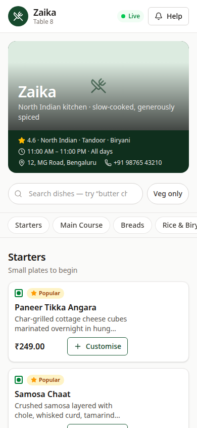
*Guest digital menu interface with category filtering, dietary indicators, and item cards.*

#### Order Tracking Lifecycle
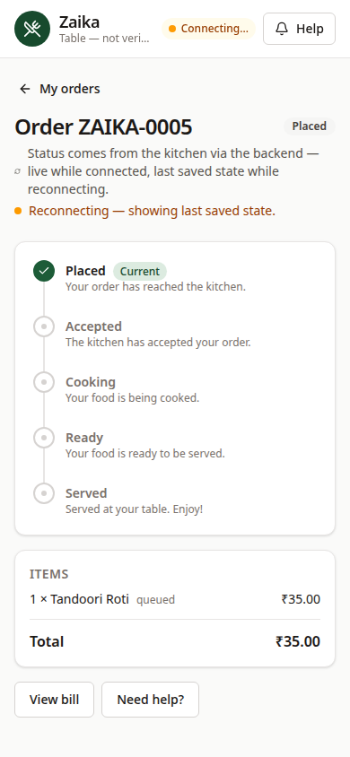
*Live guest tracking: Order received and placed.*

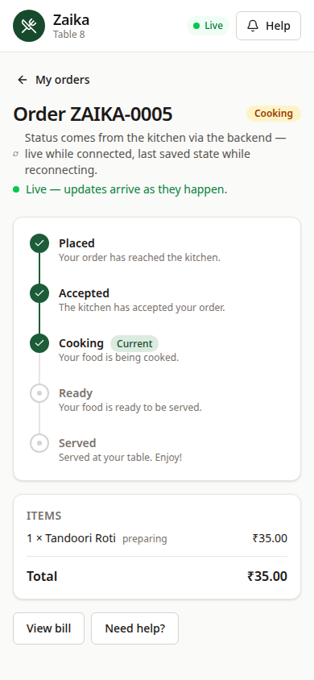
*Live guest tracking: Kitchen updates status to Preparing/Cooking.*

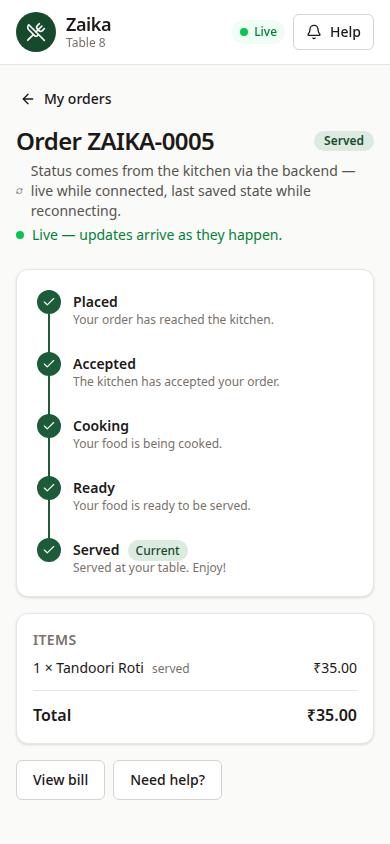
*Live guest tracking: Waiter confirms order served at table.*

#### Help Requests
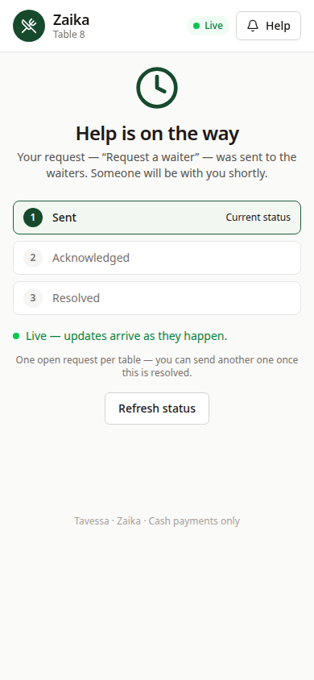
*Guest help request submitted with live waiting status.*

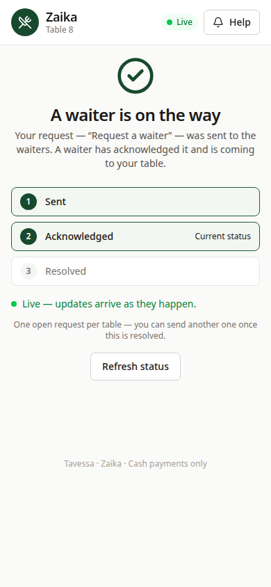
*Live notification when staff acknowledges the guest's help request.*

#### Billing & Receipt
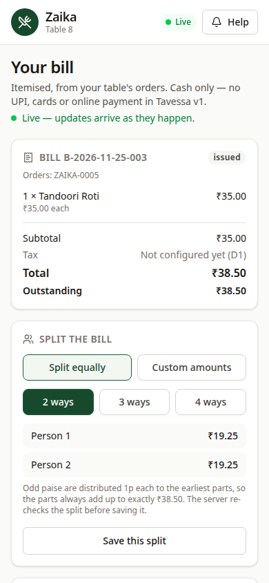
*Itemized bill view on guest phone with cash payment request option.*

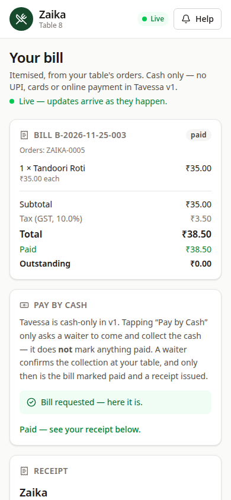
*Paid receipt displayed immediately after waiter confirms cash collection.*

---

### 🖥️ Kitchen Display System (KDS)
- **Three-column board** — New / Preparing / Ready
- **One-tap transitions** — Move orders through the kitchen workflow
- **Elapsed timers** — Server-computed time since placement
- **WebSocket-driven** — Instant updates, no polling

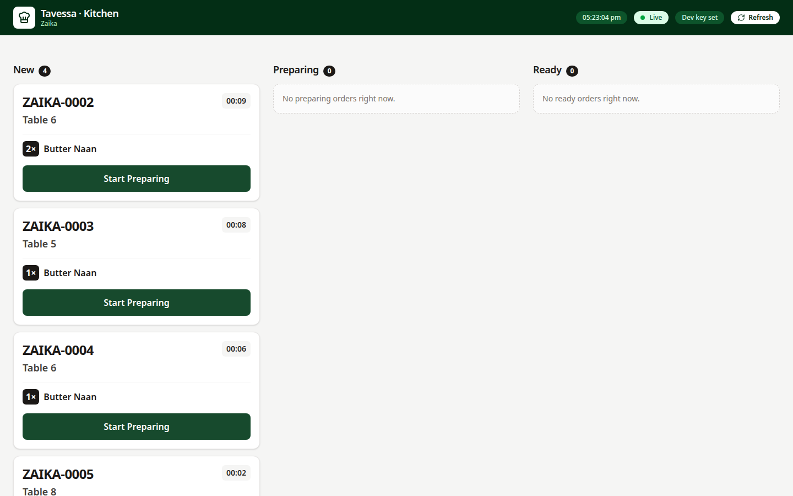
*Kitchen Display System (KDS) board with multi-column ticket management and elapsed timers.*

---

### 👨‍🍳 Staff / Waiter Dashboard
- **Floor Grid** — Live table status (available/occupied/cleaning) with order & help indicators
- **Order Management** — View all active orders, mark as served
- **Help Call Queue** — Acknowledge and resolve guest requests
- **Billing Queue** — See payment-requested bills, confirm cash collection
- **Bill Detail** — Full bill breakdown, split view, record payments with idempotent receipts

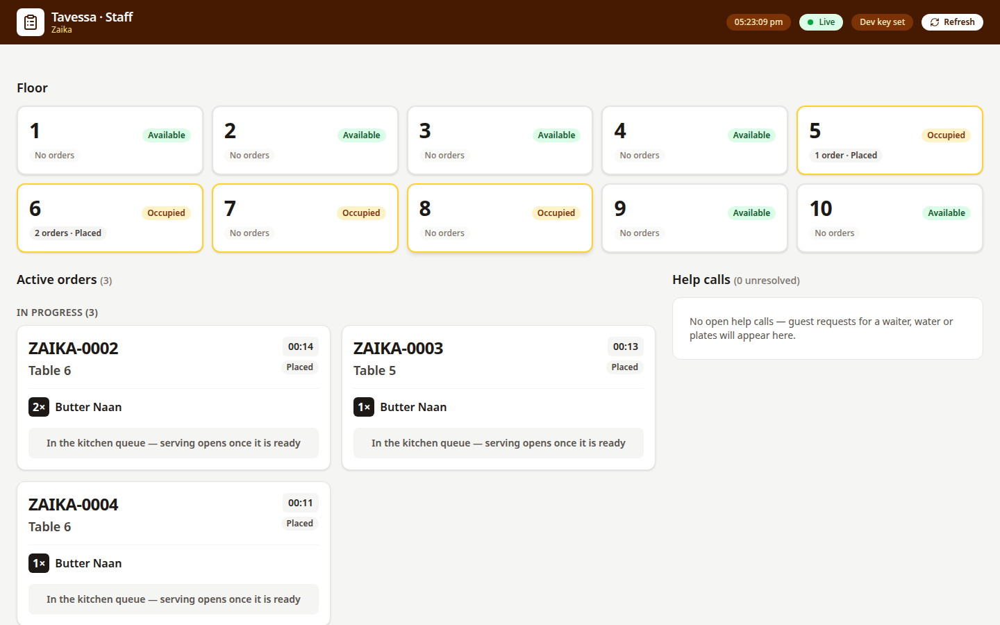
*Staff dashboard billing queue with order itemization, split breakdown, and cash payment confirmation.*

---

### 🏢 Admin / Owner Panel
- **Dashboard Overview** — Gross sales, cash collected, refunds, net cash, best sellers, recent activity
- **Order History** — Paginated, filterable order list with status breakdown
- **Bill Management** — View all bills, void bills with reason, process refunds
- **Menu Management** — CRUD categories, items, variants, add-ons; toggle availability
- **Staff Management** — Create/edit users (owner, manager, waiter, kitchen), set permissions
- **Table Management** — View/update table statuses
- **Tax Configuration** — Set tax rate, mode (inclusive/exclusive), label; snapshots on freeze
- **Cash Reports** — Daily cash reconciliation: collected, refunds, net, outstanding
- **Audit Logs** — Full audit trail of logins, password changes, voids, refunds, settings changes
- **Restaurant Settings** — Edit name, tagline, cuisine, address, contact info

#### Owner Overview
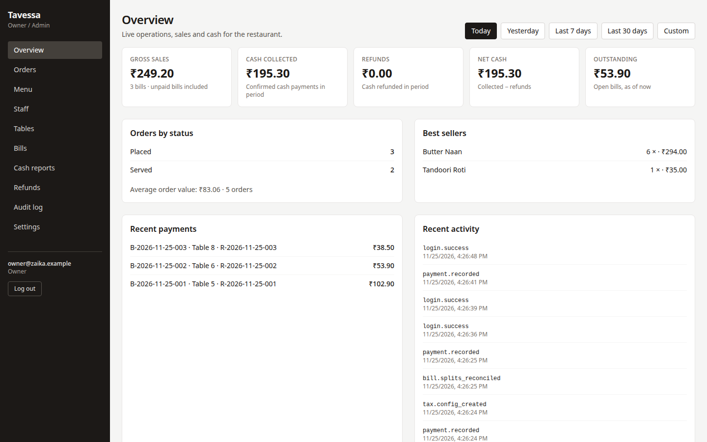
*Admin dashboard overview displaying gross sales, net cash, and key operational metrics.*

#### Tax Configuration
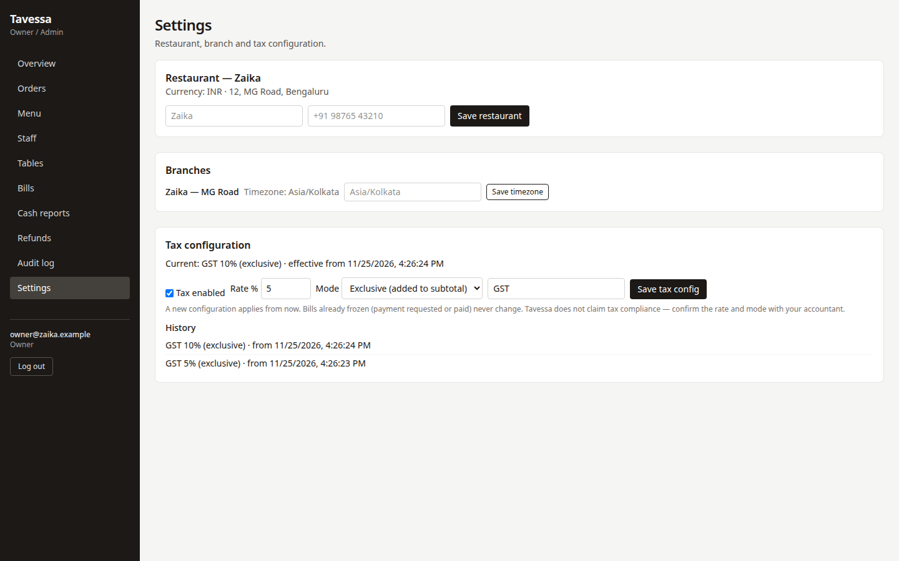
*Tax configuration interface supporting rate settings and inclusive/exclusive calculation modes.*

#### Menu & Price Management
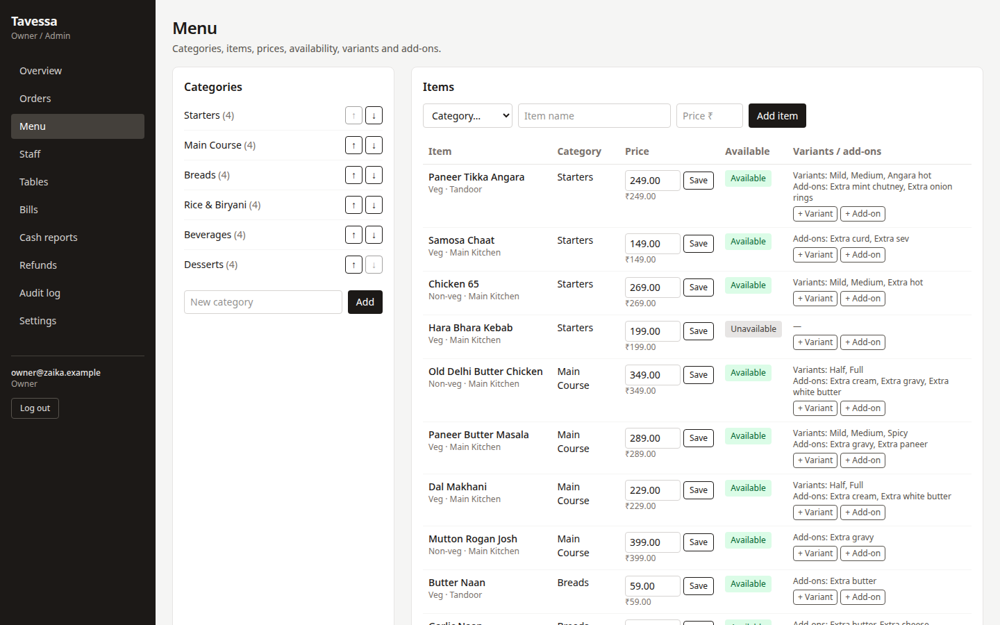
*Menu management interface for updating dish details, prices, and stock availability.*

---

### 🔐 Security & Auth
- **JWT Authentication** — Access + refresh token rotation with reuse detection
- **Role-Based Access Control** — Owner / Manager / Waiter / Kitchen with configurable permissions
- **Argon2id Password Hashing** — Industry-standard password storage
- **Rate Limiting** — Session opening and order placement throttled
- **Idempotent Order Placement** — Single-transaction crash-safe design with PostgreSQL speculative insertion

---

## Limits of this demo

This release is a frozen proof-of-concept demo, not an enterprise production system. Be aware of the following known limitations:

1. **Free Render PostgreSQL Lifespan:** The free-tier database on Render is temporary and expires approximately 30 days after creation (around 26 December 2026). It contains demo data only and must never be used for real monetary transactions.
2. **Cold Starts / Free Instance Sleep:** The backend runs on Render's free web service tier, which spins down after ~15 minutes of inactivity. The first request after a period of idle sleep takes approximately 50–70 seconds to wake up.
3. **Tax Unconfigured by Default:** In the demo database, tax rate is 0% by default unless configured by the owner in the admin settings panel.
4. **No Forgot-Password Flow:** Password resets are not self-service; staff and owner credentials must be managed via CLI scripts or an authenticated administrator.
5. **QR Code Security Scope:** A photograph or forwarded link of a table QR code works from anywhere. The session token embedded in the URL is the sole authentication factor for a table session; physical presence is not cryptographically enforced.

---

## Tech Stack

| Layer | Technology |
|-------|-----------|
| **Backend** | Python 3.12 · FastAPI · SQLAlchemy 2.0 · Alembic · Pydantic v2 |
| **Frontend** | React 19 · TypeScript · Vite · TailwindCSS 4 · React Router |
| **State** | Zustand (client state) · TanStack React Query (server state cache) |
| **Database** | PostgreSQL 16 (production on Render) · SQLite (unit tests) |
| **Real-time** | WebSockets (FastAPI native) with single-use ticket authentication |
| **Auth** | JWT (python-jose) · Argon2id (argon2-cffi) · Refresh token rotation (`HttpOnly` cookie) |
| **UI Components** | Radix UI · Lucide icons · shadcn/ui patterns |
| **Testing** | pytest + httpx (backend) · Vitest + Testing Library (frontend) · Playwright (E2E) |
| **Deployment** | Vercel (frontend + REST proxy) · Render (backend API + PostgreSQL) |
| **CI/CD** | GitHub Actions · Docker Compose |

---

## Architecture

```
┌─────────────────────────────────────────────────────────────────────┐
│                        Client Devices                               │
│  ┌──────────┐   ┌──────────┐   ┌──────────┐   ┌────────────────┐  │
│  │  Guest   │   │ Kitchen  │   │  Staff   │   │   Admin/Owner  │  │
│  │ (Phone)  │   │ (Screen) │   │ (Tablet) │   │   (Desktop)    │  │
│  └────┬─────┘   └────┬─────┘   └────┬─────┘   └───────┬────────┘  │
│       │              │              │                  │            │
│       └──────────────┴──────────┬───┴──────────────────┘            │
│                            React SPA                                │
│                     (Vite · React Router)                           │
└───────────────────────────┬─────────────┬───────────────────────────┘
              REST /api/*   │             │ WSS /ws/* (Direct Ticket Auth)
                            ▼             ▼
┌─────────────────────────────────────────────────────────────────────┐
│                      Vercel Edge Proxy                              │
│              (Rewrites /api/* to Render Backend)                    │
└───────────────────────────┬─────────────────────────────────────────┘
                            │
                            ▼
┌─────────────────────────────────────────────────────────────────────┐
│               FastAPI Modular Monolith (Render API)                 │
│  ┌────────────────────────────────────────────────────────────────┐ │
│  │  API Layer (/api/v1)                                          │ │
│  │  guest · kitchen · staff · admin · orders · health · auth     │ │
│  ├────────────────────────────────────────────────────────────────┤ │
│  │  Service Layer (Broadcast-Free Business Logic)                │ │
│  │  table · order · kitchen · staff · billing · help · admin     │ │
│  │  audit · tax                                                  │ │
│  ├────────────────────────────────────────────────────────────────┤ │
│  │  Real-time                        Auth                        │ │
│  │  ConnectionManager                JWT · RBAC · Refresh tokens │ │
│  │  /ws/kitchen · /ws/staff          Argon2id · Ticket auth      │ │
│  │  /ws/guest                                                    │ │
│  ├────────────────────────────────────────────────────────────────┤ │
│  │  Data Layer (SQLAlchemy 2.0 ORM · Alembic migrations)         │ │
│  │  Restaurant · Branch · DiningTable · TableSession             │ │
│  │  MenuCategory · MenuItem · ItemVariant · ItemAddon            │ │
│  │  Order · OrderItem · OrderItemAddon                           │ │
│  │  Bill · BillItem · BillSplit · Payment                        │ │
│  │  User · RefreshSession · WsTicket · AuditLog · TaxConfig      │ │
│  │  IdempotencyKey · HelpCall                                    │ │
│  └────────────────────────────────────────────────────────────────┘ │
└─────────────────────────────┬───────────────────────────────────────┘
                              │
                    ┌─────────┴─────────┐
                    │  PostgreSQL 16    │
                    │  (Render private) │
                    └───────────────────┘
```

### Key Design Decisions

- **Modular Monolith** — Single codebase, no distributed microservices overhead; clean domain separation via services.
- **Server-Side Pricing** — The backend recomputes every price from the menu at order time. No price or total from the client is ever trusted.
- **Integer Paise** — All currency is stored and transmitted as integer paise (1/100 of a rupee, ₹1.00 = 100 paise) to prevent floating-point rounding bugs.
- **Idempotent Order Placement** — Single-transaction crash-safe design using PostgreSQL speculative insertion on a unique index.
- **Broadcast-After-Commit** — WebSocket events are published only after the database transaction commits successfully.
- **Direct-to-Render WebSockets** — WebSocket connections connect directly to Render using single-use tickets, bypassing edge proxy limitations while keeping REST same-origin via Vercel rewrites.

---

## Quick Start

### Prerequisites

- **Python** 3.12+
- **Node.js** 20+ (Node 24 recommended)
- **PostgreSQL** 16+ (or Docker)

### 1. Clone & configure

```bash
git clone https://github.com/sharmashivam102006-arch/tavessa.git
cd tavessa
cp .env.example .env
```

### 2. Start PostgreSQL

**Option A — Docker (recommended):**

```bash
docker compose up -d db
```

**Option B — Local PostgreSQL:**

Create a database named `tavessa` with user `tavessa` / password `tavessa`, or update `DATABASE_URL` in `.env`.

### 3. Backend

```bash
cd backend
pip install -r requirements.txt

# Run migrations & seed demo restaurant
alembic upgrade head
python -m app.seed          # seeds the "Zaika" demo restaurant

# Start the API server
uvicorn app.main:app --reload --port 8000
```

The API is now live at **http://localhost:8000** with interactive docs at [/docs](http://localhost:8000/docs) (development mode only).

### 4. Frontend

```bash
cd frontend
npm install
npm run dev
```

The app is now live at **http://localhost:5173**.

### 5. Try it out

| View | Local URL | Live Demo URL | Notes |
|------|-----------|---------------|-------|
| **Home** | http://localhost:5173 | https://tavessa.vercel.app | Landing page with role navigation |
| **Guest Menu** | http://localhost:5173/t/demo | https://tavessa.vercel.app/t/demo | Demo table session (Table 5, Zaika) |
| **Kitchen** | http://localhost:5173/kitchen | https://tavessa.vercel.app/kitchen | KDS screen (dev key local / staff login live) |
| **Staff** | http://localhost:5173/staff | https://tavessa.vercel.app/staff | Waiter floor & billing dashboard |
| **Admin** | http://localhost:5173/admin | https://tavessa.vercel.app/admin | Login with seeded owner credentials |
| **Login** | http://localhost:5173/login | https://tavessa.vercel.app/login | Staff/kitchen/owner sign-in |

### Docker Compose (full stack)

```bash
docker compose up --build
```

Starts PostgreSQL, the API server (port 8000), and the frontend served by Nginx (port 5173).

---

## API Reference

Base URL (Local): `http://localhost:8000/api/v1`  
Base URL (Live Proxy): `https://tavessa.vercel.app/api/v1`

### Guest Endpoints

| Method | Path | Description |
|--------|------|-------------|
| `GET` | `/guest/t/{table_token}` | Open / resume a table session |
| `GET` | `/guest/session` | Current session info |
| `GET` | `/guest/menu` | Browse menu (filter by category, search) |
| `POST` | `/orders` | Place an order (idempotent, server-priced) |
| `GET` | `/guest/orders` | List session orders |
| `GET` | `/guest/orders/{id}` | Order detail with tracking |
| `DELETE` | `/orders/{id}` | Cancel order (placed only) |
| `POST` | `/guest/help-calls` | Request assistance |
| `GET` | `/guest/help-calls` | List help calls |
| `POST` | `/guest/bill` | Create / retrieve bill |
| `GET` | `/guest/bill` | Get current bill |
| `PATCH` | `/guest/bill/request-payment` | Request cash payment |
| `POST` | `/guest/bill/splits` | Create equal / custom splits |
| `GET` | `/guest/bill/receipt` | Get receipt (after cash payment confirmed) |

### Kitchen Endpoints

| Method | Path | Description |
|--------|------|-------------|
| `GET` | `/kitchen/restaurants` | List restaurants |
| `GET` | `/kitchen/orders` | Active order queue |
| `GET` | `/kitchen/orders/{id}` | Order detail |
| `PATCH` | `/kitchen/orders/{id}` | Transition order status |

### Staff Endpoints

| Method | Path | Description |
|--------|------|-------------|
| `GET` | `/staff/restaurants` | List restaurants |
| `GET` | `/staff/tables` | Floor grid with live status |
| `GET` | `/staff/tables/{id}` | Table detail + orders + help calls |
| `GET` | `/staff/orders` | Active orders |
| `PATCH` | `/staff/orders/{id}/serve` | Mark order as served |
| `GET` | `/staff/help-calls` | Open help calls |
| `PATCH` | `/staff/help-calls/{id}` | Acknowledge / resolve help call |
| `GET` | `/staff/bills` | Billing queue |
| `GET` | `/staff/bills/{id}` | Bill detail |
| `POST` | `/staff/bills/{id}/payments` | Confirm cash payment (idempotent) |
| `GET` | `/staff/bills/{id}/receipt` | Get receipt |

### Admin Endpoints

| Method | Path | Description |
|--------|------|-------------|
| `GET` | `/admin/overview` | Dashboard KPIs & financials |
| `GET` | `/admin/orders` | Paginated order history |
| `GET` | `/admin/bills` | All bills with financials |
| `POST` | `/admin/bills/{id}/void` | Void a bill |
| `POST` | `/admin/bills/{id}/refund` | Process refund |
| `GET` | `/admin/cash` | Daily cash report |
| `GET/POST/PATCH` | `/admin/menu/*` | Menu CRUD |
| `GET/POST/PATCH` | `/admin/staff/*` | Staff management |
| `GET/POST` | `/admin/settings/tax` | Tax configuration |
| `GET/PATCH` | `/admin/settings` | Restaurant settings |
| `GET` | `/admin/audit-logs` | Audit log |

### Auth Endpoints

| Method | Path | Description |
|--------|------|-------------|
| `POST` | `/auth/login` | Login (returns access token + sets `HttpOnly` refresh cookie) |
| `POST` | `/auth/refresh` | Rotate refresh token |
| `POST` | `/auth/logout` | Revoke refresh token |
| `POST` | `/auth/change-password` | Change password |
| `GET` | `/auth/me` | Current user info |
| `POST` | `/ws/tickets` | Issue single-use WebSocket ticket |

### WebSocket Channels

| Path | Auth | Description |
|------|------|-------------|
| `/ws/kitchen` | Ticket or dev key | Kitchen order events |
| `/ws/staff` | Ticket or dev key | Staff events (orders, help calls, bills) |
| `/ws/guest` | Single-use ticket only | Guest session events (order status, help, billing) |

---

## Project Structure

```
tavessa/
├── backend/
│   ├── alembic/                    # Database migrations
│   │   └── versions/               # Migration scripts (Stages 3–8)
│   ├── app/
│   │   ├── api/v1/                 # Route handlers
│   │   │   ├── admin.py            # Owner/admin endpoints
│   │   │   ├── guest.py            # Guest endpoints (QR session, menu, orders, billing)
│   │   │   ├── kitchen.py          # KDS endpoints
│   │   │   ├── orders.py           # Order placement & cancellation
│   │   │   ├── staff.py            # Waiter/staff endpoints
│   │   │   ├── health.py           # Health check
│   │   │   └── websocket.py        # WebSocket handlers
│   │   ├── auth/                   # Authentication & authorization
│   │   │   ├── bootstrap.py        # Seed default owner CLI
│   │   │   ├── deps.py             # Auth dependencies (JWT, permissions)
│   │   │   ├── models.py           # User, RefreshSession, WsTicket models
│   │   │   ├── permissions.py      # RBAC permission matrix
│   │   │   ├── router.py           # Auth routes (login, refresh, logout)
│   │   │   ├── service.py          # Auth business logic
│   │   │   └── tokens.py           # JWT & token utilities
│   │   ├── core/                   # Framework concerns
│   │   │   ├── config.py           # Settings (pydantic-settings)
│   │   │   ├── deps.py             # FastAPI dependencies
│   │   │   ├── errors.py           # Structured error handling
│   │   │   ├── logging.py          # Logging configuration
│   │   │   ├── rate_limit.py       # SlowAPI rate limiting
│   │   │   └── security.py         # Argon2id password hashing
│   │   ├── db/                     # Database session & base model
│   │   ├── models/                 # SQLAlchemy ORM models
│   │   │   ├── billing.py          # Bill, BillItem, BillSplit, Payment
│   │   │   ├── common.py           # Mixins (IdMixin, TimestampMixin)
│   │   │   ├── idempotency.py      # IdempotencyKey
│   │   │   ├── menu.py             # MenuCategory, MenuItem, ItemVariant, ItemAddon
│   │   │   ├── order.py            # Order, OrderItem, OrderItemAddon
│   │   │   └── restaurant.py       # Restaurant, Branch
│   │   ├── realtime/               # WebSocket connection manager
│   │   ├── schemas/                # Pydantic request/response schemas
│   │   ├── services/               # Business logic (broadcast-free)
│   │   │   ├── admin_service.py    # Dashboard, reports, menu/staff CRUD
│   │   │   ├── audit_service.py    # Audit log writer
│   │   │   ├── billing_service.py  # Bills, splits, cash payments, receipts
│   │   │   ├── help_service.py     # Help call lifecycle
│   │   │   ├── kitchen_service.py  # KDS reads & order transitions
│   │   │   ├── order_service.py    # Order placement (idempotent, server-priced)
│   │   │   ├── staff_service.py    # Floor grid, serving, help resolution
│   │   │   ├── table_service.py    # QR sessions, menu reads
│   │   │   └── tax_service.py      # Tax configuration & computation
│   │   ├── main.py                 # FastAPI app factory
│   │   └── seed.py                 # Demo data seeder (Zaika restaurant)
│   ├── tests/                      # pytest test suite
│   ├── alembic.ini                 # Alembic configuration
│   └── requirements.txt            # Python dependencies
│
├── frontend/
│   ├── src/
│   │   ├── app/                    # App shell, router, providers
│   │   ├── features/
│   │   │   ├── admin/              # Owner dashboard (overview, orders, bills, menu, staff, settings)
│   │   │   ├── auth/               # Login page, auth guards
│   │   │   ├── guest/              # Guest experience (menu, cart, orders, tracking, bill, help)
│   │   │   ├── kitchen/            # Kitchen Display System (3-column board)
│   │   │   └── staff/              # Waiter dashboard (floor grid, orders, billing, help calls)
│   │   ├── shared/                 # Shared API client, types, components, stores
│   │   └── lib/                    # Utility functions
│   ├── vercel.json                 # Vercel proxy & SPA rewrite configuration
│   ├── components.json             # shadcn/ui configuration
│   ├── package.json
│   ├── tsconfig.json
│   └── vite.config.ts
│
├── docs/
│   ├── deployment.md               # Production deployment guide
│   ├── stage9-screenshots/         # Verified end-to-end screenshots
│   ├── architecture.md             # Full architecture specification
│   ├── api-plan.md                 # API specification
│   └── database-design.md          # Schema & ER design
├── .github/workflows/ci.yml       # CI: backend tests + frontend typecheck & build
├── docker-compose.yml              # PostgreSQL + API + Frontend
├── Dockerfile.backend              # Python 3.12 slim
├── Dockerfile.frontend             # Node build → Nginx
├── render.yaml                     # Render Blueprint specification
├── .env.example                    # Environment variable reference
└── .gitignore
```

---

## Development & Verification

### Running Tests

**Backend** (uses SQLite in-memory for rapid unit tests):

```bash
cd backend
python -m pytest -q
```

**Frontend** (Vitest):

```bash
cd frontend
npm test
```

### Database Migrations

```bash
cd backend
alembic upgrade head
```

---

## Permission Matrix

| Capability | Owner | Manager | Waiter | Kitchen |
|-----------|-------|---------|--------|---------|
| View dashboard | ✅ | ✅ | ❌ | ❌ |
| Manage settings | ✅ | 🔧 | ❌ | ❌ |
| Manage menu | ✅ | ✅ | ❌ | ❌ |
| Manage staff | ✅ | 🔧 | ❌ | ❌ |
| View financials | ✅ | ✅ | ❌ | ❌ |
| Confirm cash | ✅ | ✅ | ✅ | ❌ |
| Serve orders | ✅ | ✅ | ✅ | ❌ |
| Update kitchen | ✅ | ✅ | ❌ | ✅ |
| View kitchen | ✅ | ✅ | ❌ | ✅ |
| Configure tax | ✅ | ❌ | ❌ | ❌ |
| Issue refunds | ✅ | 🔧 | ❌ | ❌ |
| Void bills | ✅ | 🔧 | ❌ | ❌ |

🔧 = Configurable per manager (flags on the user record)

---

## Contributing

1. Fork the repository
2. Create a feature branch (`git checkout -b feature/my-feature`)
3. Commit your changes (`git commit -m 'Add my feature'`)
4. Push to the branch (`git push origin feature/my-feature`)
5. Open a Pull Request

Please ensure:
- Backend tests pass: `cd backend && python -m pytest -q`
- Frontend builds: `cd frontend && npm run build`
- Code follows existing patterns and conventions

---

## License

This project is provided as-is for educational and demonstration purposes.
